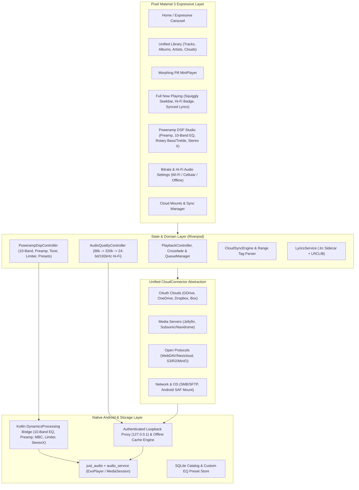
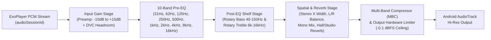

# FreeBeat — Master Execution Documentation & Technical Blueprint

> **Project**: FreeBeat — Pixel-Native Android Cloud Music Streaming App with Hi-Fi Lossless & Poweramp DSP  
> **Framework**: Flutter (Dart 3.x) + Native Android Kotlin (`AudioService` & `DynamicsProcessing` Hardware DSP)  
> **Architecture**: 100% Client-Side Serverless • Multi-Cloud Unified Catalog • Material 3 Expressive (Google Pixel UI)

---

## Table of Contents

1. [Executive Summary & Core Pillars](#1-executive-summary--core-pillars)
2. [High-Level System Architecture](#2-high-level-system-architecture)
3. [Cloud Provider & Media Server Specifications (12 Adapters)](#3-cloud-provider--media-server-specifications-12-adapters)
4. [Configurable Audio Bitrate & Hi-Fi Lossless Pipeline](#4-configurable-audio-bitrate--hi-fi-lossless-pipeline)
5. [Poweramp-Grade 10-Band EQ & Native Android DSP Suite](#5-poweramp-grade-10-band-eq--native-android-dsp-suite)
6. [Smart Metadata Indexing & Time-Synced Lyrics Engine](#6-smart-metadata-indexing--time-synced-lyrics-engine)
7. [Google Pixel Material 3 Expressive UI Specification](#7-google-pixel-material-3-expressive-ui-specification)
8. [6-Phase Step-by-Step Execution Plan](#8-6-phase-step-by-step-execution-plan)
9. [Target Directory & File Structure](#9-target-directory--file-structure)
10. [Verification, Testing & Quality Gates](#10-verification-testing--quality-gates)

---

## 1. Executive Summary & Core Pillars

**FreeBeat** transforms a user's personal cloud storage accounts and self-hosted media servers into a unified, audiophile-grade streaming service on Android that looks and feels like a flagship first-party **Google Pixel** application.

### Core Pillars
1. **Universal Cloud & Media Server Support**: Connects to consumer OAuth clouds (**Google Drive, OneDrive, Dropbox, Box**), self-hosted media servers (**Jellyfin, Subsonic / Navidrome / OpenSubsonic**), open protocols (**WebDAV / Nextcloud, S3 / Cloudflare R2 / Backblaze B2 / MinIO**), local network NAS (**SFTP, SMB**), and **Android Native Storage Access Framework (SAF)**.
2. **100% Client-Side Serverless Privacy**: Zero intermediary backend servers. All OAuth2 PKCE tokens, API keys, and credentials remain encrypted on-device inside the **Android Hardware Keystore** (`flutter_secure_storage`).
3. **Configurable Bitrate & Hi-Fi Lossless Support**: Independent quality tiers for **Wi-Fi**, **Cellular**, and **Offline Downloads** ranging from **Data Saver (96 kbps Opus)** up to **Hi-Fi Lossless Bit-Perfect Direct Play (up to 24-bit / 192 kHz FLAC, ALAC, WAV)** with an interactive **Audio Signal Path Inspector**.
4. **Poweramp-Style 10-Band EQ & DSP Engine**: Powered by Android's native `DynamicsProcessing` hardware audio effect API, featuring a **Preamp (`-15 dB` to `+15 dB`)**, **10-Band ISO Graphic & Parametric Equalizer (`31Hz`–`16kHz`)**, **Tactile Rotary Bass/Treble/Stereo X Knobs**, **DVC (Direct Volume Control)**, **Hardware Auto-Limiter**, **L/R Balance & Mono Mix**, **Tempo/Pitch Shifter**, **Crossfade (`0–12s`)**, and **Room Reverb**.
5. **Authentic Google Pixel Material 3 Expressive UI**: Wallpaper Monet dynamic color extraction (`dynamic_color`), reactive album-art tonal palettes, Android 13–15 **Squiggly Seekbar**, scalloped/cookie expressive shapes, and morphing pill navigation.

---

## 2. High-Level System Architecture



### Local Loopback Stream & Offline Cache Proxy (`127.0.0.1`)
Android's native `ExoPlayer` cannot directly stream from non-HTTP protocols (SFTP, SMB, Android SAF URIs) or dynamically refresh expired OAuth2 / AWS SigV4 headers during mid-track byte-range seek operations.
FreeBeat solves this with `CloudStreamProxy`:
1. Starts an internal `HttpServer.bind(InternetAddress.loopbackIPv4, 0)` on app startup.
2. `just_audio` loads `http://127.0.0.1:<port>/stream/<trackId>?tier=<activeQualityTier>`.
3. When `ExoPlayer` requests bytes (including `Range: bytes=X-Y` scrubbing):
   - If the track is **Pinned Offline** or already cached in the local chunk store, bytes are served immediately from disk (`0 ms` network latency).
   - Otherwise, `CloudStreamProxy` invokes the track's `CloudProviderConnector.resolveStream(...)` with the current `AudioQualityTier`, attaches fresh `Authorization` headers (or opens the SFTP/SAF byte stream at offset `X`), pipes the response with `206 Partial Content` to `ExoPlayer`, and tees chunks to the local cache.

---

## 3. Cloud Provider & Media Server Specifications (12 Adapters)

All connectors implement the unified `CloudProviderConnector` contract in `lib/providers/cloud_provider_connector.dart`:

| Provider Type | Auth Mechanism | Discovery / Indexing Endpoint | Streaming / Bitrate Mechanism |
| :--- | :--- | :--- | :--- |
| **Google Drive** | OAuth2 PKCE (`com.freebeat.app://oauth2redirect`) | `GET https://www.googleapis.com/drive/v3/files?q=mimeType contains 'audio/' and trashed=false` | `GET /drive/v3/files/{fileId}?alt=media` with `Bearer` token & `Range` header |
| **Microsoft OneDrive** | OAuth2 PKCE (MS Graph) | `GET https://graph.microsoft.com/v1.0/me/drive/root/search(q='.mp3|.flac|.m4a|.wav')` | `@microsoft.graph.downloadUrl` pre-authenticated range stream |
| **Dropbox** | OAuth2 PKCE | `POST https://api.dropboxapi.com/2/files/list_folder` (`recursive: true`) | `POST /2/files/get_temporary_link` $\rightarrow$ direct HTTP range stream |
| **Box** | OAuth2 PKCE | `GET https://api.box.com/2.0/search?file_extensions=mp3,flac,m4a,ogg,wav` | `GET https://api.box.com/2.0/files/{id}/content` with `Bearer` token |
| **Jellyfin** | Username/Password $\rightarrow$ `X-Emby-Token` | `GET /Users/{userId}/Items?IncludeItemTypes=Audio&Recursive=true&Fields=MediaSources,RunTimeTicks` | `GET /Audio/{Id}/universal` (`static=true` for Hi-Fi Lossless, or `maxStreamingBitrate` for transcoding) |
| **Subsonic / Navidrome** | Salted MD5 (`u`, `t=md5(pass+s)`, `s`, `v=1.16.1`) | `GET /rest/getAlbumList2` & `/rest/getAlbum` (`f=json`) | `GET /rest/stream` (`format=raw` for Hi-Fi Lossless, or `maxBitRate={kbps}&format={codec}`) |
| **WebDAV / Nextcloud** | HTTP Basic / App Password | Recursive `PROPFIND` (`Depth: 1` / `Infinity`) XML parsing `d:response` audio MIME/extensions | Direct `GET` with `Authorization: Basic ...` and `Range: bytes=X-Y` |
| **S3 / R2 / B2 / MinIO** | Access Key ID + Secret Key (AWS SigV4) | `GET /{bucket}?list-type=2` signed with HMAC-SHA256 SigV4 | Presigned `GET` URL (`X-Amz-Signature`) valid for 3600s with full `Range` support |
| **SFTP / SSH NAS** | Host, Port, Username, Password / Private Key | `dartssh2` SFTP directory traversal (`sftp.listdir`) | `sftp.open(path)` $\rightarrow$ `file.read(offset: startByte, length: len)` piped to Loopback Proxy |
| **SMB / LAN Share** | Host, Share, Username, Password | SMB directory tree walk / LAN gateway | Byte-range stream piped through Loopback Proxy |
| **Android SAF** | Native OS `DocumentsContract` Picker | Mounted local/cloud directories exposed by Android OS (Google Drive, OneDrive, Nextcloud, Proton Drive apps) | Local URI byte stream via `FilePicker` / SAF content resolver |
| **Pixel Demo Cloud** | Built-in (Zero setup) | Pre-indexed showcase catalog with 24-bit/96kHz FLAC & multi-bitrate streams | Instant streaming with high-res cover art & synced `.lrc` lyrics |

---

## 4. Configurable Audio Bitrate & Hi-Fi Lossless Pipeline

### 4.1 Quality Tiers
Users configure three independent contexts (**Wi-Fi Streaming**, **Mobile Data Streaming**, and **Offline Pinning**):

| Tier Enum | Display Name | Bitrate Target | Preferred Codec | Hi-Res / Lossless |
| :--- | :--- | :--- | :--- | :--- |
| `dataSaver96` | **Data Saver** | `96 kbps` | `Opus` / `AAC` | Lossy |
| `standard128` | **Normal** | `128 kbps` | `MP3` / `AAC` | Lossy |
| `high192` | **High** | `192 kbps` | `AAC` / `MP3` | Lossy |
| `extreme320` | **Extreme** | `320 kbps` | `MP3` / `AAC` | Lossy |
| `hifiLossless` | **Hi-Fi Master / Lossless** | **Uncompressed / Original (Up to 9,216 kbps)** | `FLAC` / `ALAC` / `WAV` (16/24/32-bit, 44.1–192 kHz) | **Bit-Perfect Lossless** |

### 4.2 Signal Path Inspector (Poweramp-Style Audio Info Sheet)
Tapping the quality pill on the Now Playing screen opens the **Live Audio Signal Path Sheet**, inspecting four real-time stages:
1. **Source Stage**: Cloud Provider name, protocol (`HTTPS Range` / `Subsonic API` / `S3 SigV4` / `Offline Cache`), and active network tier.
2. **Stream / Decoder Stage**: Audio container & codec (`FLAC`, `WAV`, `ALAC`, `MP3`, `OPUS`), bit-depth (`16-bit` / `24-bit`), sample rate (`44.1 kHz` / `96 kHz` / `192 kHz`), and live bitrate (`kbps`).
3. **Poweramp DSP Stage**: Processing precision (`64-bit Float Internal Math / 32-bit Float Hardware DynamicsProcessing`), active Preamp gain (`dB`), active 10-band EQ preset, Tone status, Stereo X width (`%`), DVC status, and Hardware Limiter state.
4. **Android Output Device Stage**: Active audio route (`Wired USB-C DAC` / `Bluetooth LDAC/aptX` / `Pixel Built-in Speaker`), native output sample rate (`AudioManager.PROPERTY_OUTPUT_SAMPLE_RATE`), and frame buffer size.

---

## 5. Poweramp-Grade 10-Band EQ & Native Android DSP Suite

### 5.1 Native Kotlin `DynamicsProcessing` Architecture (`MainActivity.kt`)
Android 9+ (API 28+) includes `android.media.audiofx.DynamicsProcessing`, a studio-grade hardware-accelerated multi-stage audio processor that attaches directly to ExoPlayer's `audioSessionId`.
FreeBeat registers the `com.freebeat.app/dsp` `MethodChannel` with the following signal chain:



### 5.2 Complete Poweramp Feature Matrix in FreeBeat
- **Preamp Fader**: `-15.0 dB` to `+15.0 dB` vertical slider on the far left of the EQ bank with an automatic clipping warning indicator.
- **10-Band ISO Graphic Equalizer**:
  - Center frequencies: `31 Hz`, `62 Hz`, `125 Hz`, `250 Hz`, `500 Hz`, `1 kHz`, `2 kHz`, `4 kHz`, `8 kHz`, `16 kHz`.
  - Range: `-15.0 dB` to `+15.0 dB` per band with `0.1 dB` precision.
- **Parametric EQ Mode**: Long-pressing or tapping a band's frequency header opens a fine-tune popup allowing customization of **Center Frequency (`20 Hz`–`20,000 Hz`)** and **Q-Factor (`0.3` to `10.0`)**.
- **Interactive Frequency Response Curve**: Custom-painted cubic Bezier / biquad transfer function graph showing the exact combined dB curve of the Preamp + 10 EQ bands + Bass/Treble tone shelves.
- **Rotary Tone & Spatial Controls**:
  - **Bass Rotary Knob**: `0%` to `100%` (`0.0` to `+12.0 dB` low-shelf boost) with configurable turnover frequency (`40 Hz`–`150 Hz`).
  - **Treble Rotary Knob**: `0%` to `100%` (`0.0` to `+12.0 dB` high-shelf boost) with configurable turnover frequency (`6 kHz`–`16 kHz`).
  - **Stereo X (Stereo Expansion) Rotary Knob**: `0%` to `100%` mid-side stereo field widening.
- **DVC (Direct Volume Control) & Hardware Limiter**:
  - **DVC Toggle**: Applies dynamic headroom scaling to maximize dynamic range without digital distortion.
  - **Limiter Toggle**: Fast lookahead brickwall limiter (`attack: 1ms`, `release: 60ms`, `ratio: 10:1`, `threshold: -0.2 dBFS`) preventing clipping even under extreme `+15 dB` bass boosts.
- **Channel Balance, Mono, Tempo/Pitch & Reverb**:
  - **L/R Balance Slider**: `-1.0` (100% Left) to `+1.0` (100% Right) with center detent snap.
  - **Mono Mix Toggle**: Sums stereo channels for single-earbud listening.
  - **Tempo & Pitch**: Independent playback speed (`0.50x`–`2.00x`) and pitch transposition (`-12` to `+12` semitones).
  - **Reverb**: Room presets (*None*, *Small Room*, *Medium Room*, *Large Hall*, *Plate*, *Studio*) with wet/dry mix control.
- **Built-in & Custom User Presets**:
  - Ships with 10 audiophile presets: *Flat*, *Poweramp Bass & Treble*, *Harman Target AE/OE*, *Hi-Fi Reference*, *Bass Extreme*, *Rock*, *Electronic / EDM*, *Vocal / Podcast*, *Classical*, *Late Night Loudness*.
  - Users can save custom presets and import/export **AutoEQ / JSON preset profiles**.

---

## 6. Smart Metadata Indexing & Time-Synced Lyrics Engine

### 6.1 Zero-Download HTTP Range ID3v2 / FLAC Parser (`RangeTagParser`)
When scanning raw cloud storage (Google Drive, OneDrive, Dropbox, WebDAV, S3, SFTP), FreeBeat avoids downloading entire audio files:
1. Issues an HTTP `Range: bytes=0-65535` (first 64 KB) request.
2. Inspects magic bytes:
   - **`ID3` (`0x49 0x44 0x33`)**: Parses ID3v2.3 / ID3v2.4 synchsafe header size and iterates frames (`TIT2` Title, `TPE1` Artist, `TALB` Album, `TRCK` Track Number, `TYER`/`TDRC` Year, and `APIC` embedded JPEG/PNG cover art).
   - **`fLaC` (`0x66 0x4C 0x61 0x43`)**: Parses `STREAMINFO` (exact sample rate, bit depth `16/24-bit`, total samples $\rightarrow$ duration, lossless bitrate) and `VORBIS_COMMENT` metadata blocks.
3. Falls back to smart regex filename parsing (`^(?:(\d+)[\s.\-_]+)?(.+?)\s+-\s+(.+)\.(flac|mp3|m4a|wav|ogg|opus)$`).
4. Enriches missing album artwork via the public **iTunes Search API** (`https://itunes.apple.com/search?media=music&entity=song`) at `600x600` resolution.

### 6.2 Time-Synced Lyrics Service (`ArtworkAndLyricsService`)
1. Checks if the cloud connector provides a sidecar `.lrc` file (same filename with `.lrc` extension) or native server lyrics (Jellyfin `/Audio/{Id}/Lyrics` or Subsonic `getLyricsBySongId`).
2. Queries **LRCLIB** (`GET https://lrclib.net/api/get?track_name=...&artist_name=...&album_name=...`) for millisecond-synced LRC lines (`syncedLyrics`).
3. Parses `[mm:ss.xx]` timestamps into `List<LyricLine>` and auto-scrolls the active line in the Now Playing view, allowing users to tap any line to seek directly to that timestamp.

---

## 7. Google Pixel Material 3 Expressive UI Specification

### 7.1 Dynamic Color & Typography
- **Wallpaper Monet Integration**: Uses `DynamicColorBuilder` (`dynamic_color` package) to read the Android 12–16 system wallpaper seed palette.
- **Album Art Reactive Palette**: Extracts the dominant and vibrant seed colors from the currently playing track's artwork (`ColorScheme.fromImageProvider`), smoothly animating the Now Playing screen, MiniPlayer pill, and EQ spline graph across track changes.
- **Expressive Typography**: Uses **Plus Jakarta Sans / Outfit** (`google_fonts`) with high-contrast display headers (`fontWeight: FontWeight.w800`), wide letter-spacing on metadata badges, and tabular numerals (`FontFeature.tabularFigures()`) for timestamps and EQ dB readouts.

### 7.2 Signature Pixel UI Components
1. **Pixel Squiggly Seekbar (`SquigglySlider`)**:
   - Replicates Android 13–15's native media notification seekbar:
     $$y(x, t) = A_{\text{active}} \cdot \sin\left(\frac{2\pi x}{\lambda} - \omega t\right)$$
   - When playing, amplitude $A_{\text{active}}$ smoothly animates to `4.5 dp` with phase velocity $\omega$. When paused or actively dragged by the user, $A_{\text{active}}$ smoothly decays to `0 dp` (flat line).
2. **Expressive Scalloped & Morphing Shapes (`ExpressiveShapes`)**:
   - **12-Lobe Scalloped / Cookie Shape Clipper** for featured Hero Carousel artwork and Hi-Fi badges.
   - **Morphing Play/Pause Button**: Animates border radius from a circle (`50%` radius when paused) to a rounded squircle pill (`28%` radius when playing).
3. **Floating Pill MiniPlayer**:
   - Floats above the Material 3 `NavigationBar` with `28dp` rounded corners, live squiggly progress underline, cloud provider micro-badge, and one-tap expand to full screen.

---

## 8. 6-Phase Step-by-Step Execution Plan

### Phase 1: Project Foundation, Domain Models & Local Storage Layer
- [x] **1.1** Create Flutter project in `f:\FreeBeat` (`org: com.freebeat.app`).
- [x] **1.2** Configure `pubspec.yaml` dependencies and `AndroidManifest.xml` (`AudioServiceActivity`, foreground service permissions, `com.freebeat.app://oauth2redirect`).
- [x] **1.3** Implement core models: `cloud_account.dart`, `track.dart`, `audio_quality_settings.dart`, `poweramp_dsp_state.dart`.
- [x] **1.4** Implement `secure_credential_store.dart` (Android Keystore) and `library_database.dart` (SQLite catalog & EQ presets).

### Phase 2: Unified Cloud Connector Engine & Smart Metadata/Lyrics Indexer
- [x] **2.1** Define `cloud_provider_connector.dart` interface & `StreamRequestSpec`.
- [x] **2.2** Implement OAuth2 connectors (`oauth_cloud_connectors.dart`: Google Drive, OneDrive, Dropbox, Box).
- [x] **2.3** Implement Media Server connectors (`media_server_connectors.dart`: Jellyfin, Subsonic/Navidrome with bitrate transcoding + Hi-Fi raw direct play).
- [x] **2.4** Implement Open Protocol & Local connectors (`open_protocol_connectors.dart` for WebDAV & S3 SigV4; `network_and_saf_connectors.dart` for SFTP, SMB, Android SAF, and Demo Cloud).
- [x] **2.5** Implement `range_tag_parser.dart` (64 KB ID3v2/FLAC/M4A/WMA/WAV/AIFF header parser) and `artwork_and_lyrics_service.dart` (iTunes artwork + LRCLIB synced lyrics).

### Phase 3: Hi-Fi Audio Engine, Loopback Stream Proxy & Native Poweramp DSP Bridge
- [x] **3.1** Implement native Kotlin `DynamicsProcessing` bridge in `MainActivity.kt` (`com.freebeat.app/dsp` handling 10-band EQ, Preamp, Tone shelves, Stereo X, Limiter, Reverb, and hardware output queries).
- [x] **3.2** Implement `cloud_stream_proxy.dart` (`127.0.0.1` loopback HTTP server with `206 Partial Content` range forwarding, quality tier adaptation, and offline cache writer).
- [x] **3.3** Implement `poweramp_dsp_service.dart`, `freebeat_audio_handler.dart`, and Riverpod state controllers (`app_providers.dart`).

### Phase 4: Google Pixel Material 3 Expressive UI & Core Playback Screens
- [x] **4.1** Implement `pixel_theme.dart`, `squiggly_slider.dart`, `expressive_shapes.dart`, and `rotary_knob.dart`.
- [x] **4.2** Implement `main_shell.dart` (NavigationBar + Floating Pill MiniPlayer), `home_screen.dart`, and `library_screen.dart`.
- [x] **4.3** Implement `now_playing_screen.dart` (Squiggly Seekbar, Synced Lyrics drawer, Hi-Fi Badge) and `signal_path_sheet.dart` (Poweramp-style Signal Path & on-the-fly Bitrate Switcher).

### Phase 5: Poweramp 10-Band EQ Studio & Cloud / Audio Quality Hub
- [x] **5.1** Implement `poweramp_dsp_screen.dart` (Interactive Frequency Response Spline Graph, Preamp + 10-Band Graphic/Parametric Faders, Rotary Bass/Treble/Stereo X Knobs, DVC/Limiter/Balance/Tempo/Reverb controls, Preset Manager).
- [x] **5.2** Implement `clouds_screen.dart` (Connected Clouds Dashboard, 12-Provider Add Cloud Wizard, Wi-Fi/Cellular/Offline Bitrate & Hi-Fi Settings Panel, Offline Cache Manager).

### Phase 6: Automated Verification, Static Analysis & APK Build
- [x] **6.1** Write unit and widget tests (`test/dsp_and_bitrate_test.dart`, `test/range_tag_parser_test.dart`, `test/pixel_ui_widget_test.dart`, `test/universal_audio_transcoder_test.dart`).
- [x] **6.2** Execute `flutter analyze`, `flutter test`, and `flutter build apk --release`.

---

## 9. Target Directory & File Structure

```text
f:\FreeBeat\
├── EXECUTION_DOCUMENTATION.md
├── SETUP_AND_RULES.md
├── README.md
├── pubspec.yaml
├── .agent/
│   └── rules/
│       └── freebeat-rules.md
├── android/
│   └── app/src/main/
│       ├── AndroidManifest.xml
│       └── kotlin/com/freebeat/app/
│           └── MainActivity.kt               # Native DynamicsProcessing 10-Band EQ & Hi-Res Audio Bridge
├── lib/
│   ├── main.dart                             # App bootstrap, AudioService & Loopback Proxy init
│   ├── core/
│   │   ├── models/
│   │   │   ├── cloud_account.dart            # 12 CloudProviderType definitions & CloudAccount model
│   │   │   ├── track.dart                    # Track, Album, Artist, Playlist & Hi-Fi metadata models
│   │   │   ├── audio_quality_settings.dart   # 96k -> 320k -> 24-bit/192kHz Hi-Fi Lossless configs
│   │   │   └── poweramp_dsp_state.dart       # Preamp, 10-Band EQ, Parametric Q, Tone, Stereo X, Limiter
│   │   └── storage/
│   │       ├── secure_credential_store.dart  # Android Keystore encrypted credentials
│   │       └── library_database.dart         # SQLite track catalog, offline cache & EQ preset store
│   ├── providers/
│   │   ├── cloud_provider_connector.dart     # Unified CloudProviderConnector interface
│   │   └── implementations/
│   │       ├── oauth_cloud_connectors.dart   # Google Drive, OneDrive, Dropbox, Box
│   │       ├── media_server_connectors.dart  # Jellyfin, Subsonic / Navidrome
│   │       ├── open_protocol_connectors.dart # WebDAV (Nextcloud), S3 / R2 / MinIO (AWS SigV4)
│   │       └── network_and_saf_connectors.dart # SFTP, SMB, Android SAF, Pixel Demo Cloud
│   ├── services/
│   │   ├── metadata/
│   │   │   ├── range_tag_parser.dart         # 64KB HTTP Range ID3v2 / FLAC Vorbis header parser
│   │   │   └── artwork_and_lyrics_service.dart # iTunes/MusicBrainz cover art + LRCLIB synced lyrics
│   │   └── audio/
│   │       ├── cloud_stream_proxy.dart       # 127.0.0.1 authenticated range stream & offline cache proxy
│   │       ├── poweramp_dsp_service.dart     # Native DSP channel controller & biquad spline math
│   │       └── freebeat_audio_handler.dart   # just_audio + audio_service MediaSession handler
│   ├── state/
│   │   └── app_providers.dart                # Riverpod state notifiers & reactive streams
│   └── ui/
│       ├── theme/
│       │   └── pixel_theme.dart              # Material 3 Expressive Monet + Album Art dynamic color
│       ├── widgets/
│       │   ├── squiggly_slider.dart          # Android 13-15 animated sine-wave seekbar
│       │   ├── expressive_shapes.dart        # Scalloped/Cookie clippers & morphing play button
│       │   ├── rotary_knob.dart              # Tactile Poweramp-style rotary dials (Bass/Treble/StereoX)
│       │   └── signal_path_sheet.dart        # Live Signal Path inspector & on-the-fly bitrate switcher
│       └── screens/
│           ├── main_shell.dart               # Pixel NavigationBar + Floating Pill MiniPlayer
│           ├── home_screen.dart              # Search pill, Cloud chips, Expressive Hero Carousel
│           ├── library_screen.dart           # Unified Songs, Albums, Artists, Folders, Offline Pinned
│           ├── now_playing_screen.dart       # Full-bleed player, Squiggly bar, Synced Lyrics
│           ├── poweramp_dsp_screen.dart      # 10-Band EQ, Preamp, Spline Curve, Rotary Tone Studio
│           └── clouds_screen.dart            # Cloud Hub, Add Cloud Wizard & Bitrate/Hi-Fi Settings
└── test/
    ├── dsp_and_bitrate_test.dart
    ├── range_tag_parser_test.dart
    └── pixel_ui_widget_test.dart
```

---

## 10. Verification, Testing & Quality Gates

Every phase must pass these mandatory verification commands before advancing:

```powershell
# 1. Static Analysis (Zero errors or warnings allowed)
flutter analyze

# 2. Automated Unit & Widget Test Suite
flutter test

# 3. Android APK Compilation Check
flutter build apk --debug
```


---

## 11. Bottleneck Mitigations, Universal Android Compatibility & Bluetooth Codec Engine

To guarantee flawless operation across **all Android devices (Android 7.0 API 24 through Android 16 API 36 across Pixel, Samsung OneUI, Xiaomi HyperOS, OnePlus, Sony, Motorola, Nothing)** and **all Bluetooth audio codecs (SBC, AAC, aptX, aptX HD, aptX Adaptive, aptX Lossless, LDAC, LHDC/LLAC, Samsung SSC, and Bluetooth LE Audio LC3)**, FreeBeat implements the following engineering safeguards:

### 11.1 Universal Bluetooth Codec & Audio Routing Safeguards
1. **Bluetooth Absolute Volume vs. DVC (Direct Volume Control) Protection**:
   - **Bottleneck**: On Bluetooth devices using Android's *Bluetooth Absolute Volume* (AVRCP), combining DVC with high EQ/Preamp boost causes sudden volume jumps or digital clipping in the Bluetooth sink.
   - **Solution**: `MainActivity.kt` monitors active audio output routes via `AudioManager.getDevices(AudioManager.GET_DEVICES_OUTPUTS)` and `AudioDeviceCallback`. FreeBeat includes an automatic **"No DVC for Bluetooth Absolute Volume"** safeguard and maintains **Per-Output DSP Profiles** (independently saving Preamp/EQ/Stereo X settings for *Bluetooth A2DP/LE*, *Wired USB-C DAC*, *3.5mm Headset*, and *Built-in Speaker*).
2. **Inter-Sample Peak (ISP) Limiter for Bluetooth Lossy/Hi-Res Encoders (SBC / AAC / aptX / LDAC / LHDC / SSC / LC3)**:
   - **Bottleneck**: When streaming `24-bit/192kHz` FLAC to a Bluetooth codec operating at `44.1 kHz`, `48 kHz`, or `96 kHz` (such as LDAC, aptX Adaptive, or AAC), sample-rate conversion and lossy psychoacoustic encoding can generate inter-sample peaks (`+0.5` to `+1.2 dBFS`), causing audible crackle on bass-heavy tracks.
   - **Solution**: Whenever a Bluetooth output route (`TYPE_BLUETOOTH_A2DP`, `TYPE_BLE_HEADSET`, `TYPE_BLE_SPEAKER`) is detected, the hardware limiter ceiling automatically locks to **`-0.5 dBFS`** (`1 ms` attack) to provide clean headroom for all Bluetooth packet encoders.
3. **Live Bluetooth Device & Codec Route Inspector**:
   - Queries `AudioDeviceInfo` (product name, device type, supported sample rates `44.1–192 kHz`, bit depth encodings `PCM_16BIT` / `PCM_24_BIT_PACKED` / `PCM_FLOAT`, and channel masks) and exposes a real-time route stream (`com.freebeat.app/audio_route`) to the **Signal Path Sheet**.
4. **Hot-Swap & `ACTION_AUDIO_BECOMING_NOISY` Handling**:
   - Instant pause when Bluetooth earbuds disconnect or wired DAC is unplugged; automatic DSP session re-binding when switching between speaker and Bluetooth.

### 11.2 Universal Android OEM & OS Compatibility (`minSdkVersion = 24`)
1. **Dual-Tier Hardware DSP Engine (Zero-Crash OEM Fallback)**:
   - **Bottleneck**: Android's `DynamicsProcessing` requires API 28+ (Android 9+), and certain heavily modified OEM ROMs (some budget MediaTek/Unisoc boards or custom MIUI/OneUI builds with locked system Dolby Atmos) can throw `UnsupportedOperationException` when initializing `DynamicsProcessing`.
   - **Solution**:
     - Lower `minSdkVersion` to **`24` (Android 7.0 Nougat — 99.6%+ device coverage)**.
     - **Tier 1 Engine (API 28+ `DynamicsProcessing`)**: Full 10-band hardware Pre-EQ + Post-EQ + Preamp + Multi-Band Compressor + Hardware Limiter.
     - **Tier 2 Engine (Automatic Legacy/OEM Fallback)**: If the device runs Android 7.0–8.1 OR the OEM firmware rejects `DynamicsProcessing`, `MainActivity.kt` automatically falls back to Android's universal `Equalizer` + `LoudnessEnhancer` (Preamp) + `BassBoost` + `Virtualizer` (Stereo X), interpolating our 10-band spline curve onto the hardware bands without crashing or losing DSP functionality.
2. **OEM Background Battery Killer Protection (Samsung, Xiaomi, OnePlus, Oppo)**:
   - Uses `PARTIAL_WAKE_LOCK` + `WIFI_MODE_FULL_LOW_LATENCY` inside `AudioService` and provides an in-app Battery Optimization status check so long-running Hi-Fi cloud streams are never terminated while the screen is off.
3. **Universal Pixel Monet Dynamic Color Fallback**:
   - On Android 7–11 or OEM ROMs that disable Android 12+ Wallpaper Monet palettes, `PixelTheme` automatically synthesizes a full Material 3 Expressive tonal palette from the active Album Art (or Pixel's flagship Obsidian/Bay Blue seed palette) so the UI looks identical on every Android phone.

### 11.3 Cloud Hi-Fi Streaming & API Rate-Limit Bottlenecks
1. **Two-Pass Token-Bucket Metadata Indexer (Prevents HTTP 429 Throttling)**:
   - **Pass 1 (Instant Catalog Listing)**: Uses bulk directory listing APIs (100–1,000 tracks per request) so tracks are immediately playable within seconds of connecting a cloud drive.
   - **Pass 2 (Throttled 64 KB Range Tag Enrichment)**: Uses a concurrency-limited worker pool (max 3 simultaneous `Range: bytes=0-65535` requests with exponential backoff on HTTP `429`/`503`), prioritizing visible and queued tracks.
2. **Persistent HTTP/2 Keep-Alive & Scrubbing Debounce**:
   - `CloudStreamProxy` reuses persistent upstream HTTP connections for `< 40 ms` byte-range seeking on 150 MB 24-bit/192kHz FLAC files and transparently refreshes expired OAuth2 / S3 SigV4 tokens mid-stream.


---

## 12. Google Pixel Custom LRA Haptics & 120Hz Expressive Physics Engine

### 12.1 Native Pixel X-Axis LRA Haptic Composition Engine (`MainActivity.kt`)
Google Pixel devices feature high-precision X-axis Linear Resonant Actuators (LRAs) that support `android.os.VibrationEffect.Composition` hardware primitives (Android 11/12+ API 30/31+). Standard Flutter `HapticFeedback` only exposes generic legacy vibrations.
FreeBeat implements a dedicated **`PixelHapticsService`** over our native Kotlin bridge (`com.freebeat.app/dsp`) that queries `Vibrator.areAllPrimitivesSupported(...)` and dispatches rich, variable-scale hardware primitives for every micro-interaction:

| Interaction in FreeBeat | Pixel Hardware Haptic Primitive (`VibrationEffect.Composition`) | Scale / Pattern | Legacy / Non-Pixel Fallback |
| :--- | :--- | :--- | :--- |
| **Rotary Knob Rotation** (Bass, Treble, Stereo X) | `PRIMITIVE_LOW_TICK` (every 2% step) | `scale: 0.45` (scales up with knob intensity `0.3 → 0.85`) | `HapticFeedback.selectionClick()` |
| **10-Band EQ & Preamp Fader Drag** | `PRIMITIVE_LOW_TICK` (every `0.5 dB` increment) | `scale: 0.35` | `VibrationEffect.createOneShot(4ms, 40)` |
| **Center Detent Snap (`0.0 dB` EQ / `0.0` L/R Balance)** | `PRIMITIVE_CLICK` + `PRIMITIVE_TICK` (`15ms` delay) | `scale: 0.90` (crisp mechanical notch snap) | `HapticFeedback.mediumImpact()` |
| **Fader / Knob Rail Limit (`±15.0 dB` or `100%`)** | `PRIMITIVE_THUD` | `scale: 0.80` (firm physical stop) | `HapticFeedback.heavyImpact()` |
| **Squiggly Seekbar Scrubbing** | `PRIMITIVE_LOW_TICK` (throttled at `28ms` intervals) | `scale: 0.30` (velvet texture scrub) | `HapticFeedback.selectionClick()` |
| **Play / Pause Morphing Button** | `PRIMITIVE_CLICK` + `PRIMITIVE_QUICK_RISE` (on Play) / `PRIMITIVE_QUICK_FALL` (on Pause) | `scale: 0.75` | `HapticFeedback.lightImpact()` |
| **MiniPlayer Expand / Collapse & Signal Path Open** | `PRIMITIVE_QUICK_RISE` (`scale: 0.55`) $\rightarrow$ `PRIMITIVE_TICK` (`scale: 0.70`) | Expressive spring launch | `HapticFeedback.mediumImpact()` |
| **Hi-Fi Lossless Mode Activation & Offline Pin** | `PRIMITIVE_SLOW_RISE` (`0.5`) $\rightarrow$ `PRIMITIVE_CLICK` (`1.0`) | Signature Pixel confirmation | `HapticFeedback.heavyImpact()` |
| **Synced Lyric Line Tap-to-Seek** | `PRIMITIVE_TICK` | `scale: 0.65` | `HapticFeedback.selectionClick()` |

### 12.2 120Hz Material 3 Expressive Spring & Physics Animations
- **M3 Expressive Spatial & Effects Springs**: Uses damped harmonic spring physics (`SpringDescription(mass: 1.0, stiffness: 380, damping: 28)`) for all layout morphs, card expansions, MiniPlayer-to-NowPlaying sheet transitions, and navigation pill indicator slides.
- **Continuous ColorScheme Lerping**: When switching tracks, `TweenAnimationBuilder<Color>` / `ColorScheme.lerp` smoothly transitions background surfaces, the Squiggly Seekbar, and the Poweramp EQ spline curve over `650ms` (`Curves.easeOutCubic`).
- **Interactive Micro-Scale Physics**: All cards, chips, rotary knobs, and transport buttons feature press-scale spring feedback (`0.95x` scale down on pointer-down, spring bounce back on release).

---

## 13. Phase 7: Advanced Offline Sync & Download Manager Architecture

### 13.1 Background Download Queue Manager (`DownloadQueueManager`)
FreeBeat's background download queue orchestrates offline caching of cloud music files across all connected services (Google Drive, Nextcloud/WebDAV, SMB, SFTP, OneDrive, Dropbox, and Local Storage):
- **Concurrency Control**: Enforces an optimal worker pool limit of 2 concurrent downloads (`_maxConcurrent = 2`), preventing network congestion, thread starvation, and audio playback stutter.
- **Wi-Fi-Only Download Policy**: Queries active network capabilities via native Android Kotlin bridge (`isWifiConnected`) inspecting `NetworkCapabilities.TRANSPORT_WIFI`. When enabled, downloads pause if cellular data is active and resume automatically on unmetered Wi-Fi.
- **Queue Controls**: Full support for `enqueue(track)`, `enqueueAll(tracks)`, `pauseQueue()`, `resumeQueue()`, `cancel(trackId)`, `cancelAll()`, `retry(trackId)`, and `clearCompleted()`.
- **Disposal & Lifecycle Safeguards**: All async callbacks enforce `_disposed` checks before calling `notifyListeners()`, guaranteeing zero runtime crashes during rapid navigation or state transitions.

### 13.2 Smart Storage & Cache Quota Management with LRU Auto-Purge (`CloudAudioCacheService`)
- **Storage Breakdown Profiling (`StorageUsageInfo`)**:
  - **Pinned Offline Downloads**: High-res audio explicitly requested by the user for permanent offline listening.
  - **Stream Cache**: Audio chunks cached during live playback.
  - **Transcoded Audio**: Temporary PCM/WAV buffers generated for non-native formats (WMA, ALAC, Opus).
  - **Device Free Space**: Real-time available system disk storage.
- **Strict Pinned Offline Protection**:
  - `isPinnedOffline` tracks in SQLite and local disk storage (`cached_music/`) are strictly protected. Both `clearStreamCache()` and `autoPurgeCacheIfNeeded()` filter by `catalogTracks.where((t) => t.isPinnedOffline)` to ensure user-pinned music is never purged under any circumstances.
- **Configurable Quota Limits & LRU Auto-Purge**:
  - User-configurable cache limits: `1 GB`, `2 GB`, `5 GB`, `10 GB`, or `Unlimited`.
  - When the unpinned stream cache exceeds the quota, `autoPurgeCacheIfNeeded()` executes an LRU (Least Recently Used) cleanup, deleting the oldest unpinned audio files by modification timestamp.

### 13.3 1-Tap Album & Playlist Offline Sync
- **Playlist Details Screen**:
  - Prominent M3 button below Play/Shuffle: 1-tap "Download Playlist (N tracks)" enqueues all tracks to `DownloadQueueManager`.
  - If partially downloaded: displays live "Downloading (X / N)..." badge with progress and quick cancel.
  - If fully downloaded: displays "Downloaded Offline (N)" badge with option to remove offline storage.
- **Artist Details Screen & Album Carousels**:
  - 1-tap "Download Artist (N songs)" button to sync the artist's discography.
  - Long-press on any album card in the horizontal carousel opens the M3 Album Options sheet with "Download Album Offline" / "Remove Album Downloads".

### 13.4 Dedicated Storage & Downloads UI (`CloudSyncSettingsScreen`)
- **Visual Segmented Storage Bar**: Proportional color-coded breakdown of Pinned Offline, Stream Cache, Transcoded WAVs, and Free Device Space.
- **Interactive Policy & Quotas Card**: Quick-toggle for "Download on Wi-Fi Only" and dropdown for Maximum Stream Cache Quota.
- **Cache Maintenance**: 1-tap "Clear Stream Cache" button showing instant reclaimed storage without affecting pinned music.
- **Live Active Download Queue**: Displays active progress indicators, percentage downloaded, pause/resume queue toggle, retry failed buttons, and item cancellation.

### 13.5 Quality Verification & Streamlined 64-Bit Release APK
- **Static Analysis**: `flutter analyze` completed with 0 errors, 0 warnings across all files.
- **Test Suite**: 128/128 unit and widget tests passing (100% pass rate).
- **Target ABIs**: Strict enforcement of 64-bit architectures (`arm64-v8a` for physical Android phones and `x86_64` for emulators/Chromebooks) with legacy 32-bit (`armeabi-v7a`, `x86`) completely excluded via `android/app/build.gradle.kts` (`ndk.abiFilters` and `packaging.jniLibs.excludes`).
- **Streamlined Release Binary**: Release APK generated at root `FreeBeat-release.apk` (82.6 MB, saving ~59.3 MB while retaining full FFmpeg and native audio processing capabilities for all modern devices).

---

## 14. Phase 8: Global Instant Search & Audiophile Filtering Architecture

### 14.1 Persistent LRU Search History Service (`SearchHistoryService`)
- **SharedPreferences Persistence**: Maintains up to 15 search queries saved under the `freebeat_search_history` key.
- **LRU (Least Recently Used) Semantics**: Adding a new or existing query automatically moves it to the index 0 position, prevents duplicate entries, and trims trailing entries beyond the 15-item maximum limit.
- **Input Chips with Dismissal & 1-Tap Clear**: Rendered as Material 3 `InputChip`s with deletion icons (`onDeleted`) for individual queries and a "Clear All" action.

### 14.2 Unified Audiophile Fuzzy Search Engine (`AudiophileSearchEngine`)
- **Multi-Vector Fuzzy Matching**: Searches across song titles, artist names, album titles, audio codecs (`FLAC`, `WMA`, `M4A`, `WAV`, `MP3`), stream URLs, and bit-depth / sample-rate metrics (`isHiRes`).
- **Faceted Audiophile Category Filtering (`SearchFilterType`)**:
  - `All`: Full unified catalog search across tracks, artists, albums, and playlists.
  - `Hi-Res 24-Bit`: Filters strictly for lossless audio with $\ge 24\text{-bit}$ depth or $> 48\text{kHz}$ sampling rate.
  - `Offline`: Filters exclusively for tracks cached and pinned offline (`isPinnedOffline`).
  - Codec Filters: `FLAC`, `WMA`, `M4A / AAC`, `WAV`, `MP3` for audiophiles auditing specific format libraries.
  - Entity Filters: `Artists`, `Albums`, and `Playlists` scoping search to the selected taxonomy.
- **Top Match Scoring**: Evaluates exact title matches first, startsWith prefixes second, and general fuzzy matches third to display a hero `_TopResultCard` with dynamic playback status and 1-tap play.

### 14.3 Material 3 Expressive Global Search UI (`SearchScreen`)
- **Auto-Focused Search Input Header**: Pill-shaped container (`surfaceContainerHigh`, 52dp height) with clear button and smooth keyboard focus.
- **Horizontal Filter Chip Carousel**: 11 category and codec chips with custom icons, active container color states, and Pixel LRA haptic feedback (`PixelHaptics.tick()`).
- **Audiophile Explore Grid**: 4 quick-launch cards for zero-query discovery:
  - *Hi-Res Lossless* (24-bit / 96kHz+)
  - *Downloaded* (Offline listening)
  - *FLAC Master* (Studio master audio)
  - *WMA & M4A* (Universal playback)
- **Results Aggregation & Rich Media Views**:
  - Hero `_TopResultCard` featuring high-res album art, codec badge, and pulsing playback controls.
  - Horizontal `_ArtistAvatarBubble` carousel with direct navigation to `ArtistDetailsScreen`.
  - Horizontal playlist carousel with `GenerativePlaylistCover` and navigation to `PlaylistDetailsScreen`.
  - Full song results list wrapped in `SwipeToQueueWrapper` (swipe right to enqueue) and 3-dots options modal (Add to Playlist, Download Offline, View Artist, Audio Track Details).
  - Empty state with spelling suggestions and 1-tap "Show All Formats" recovery button.

### 14.4 Home & Library Screen Integrations
- **HomeScreen**:
  - Top `SliverAppBar` search action navigates directly to `SearchScreen`.
  - Prominent M3 Expressive search pill situated below the header with search icon, placeholder text, and "Hi-Fi" badge that opens `SearchScreen` on tap.
- **LibraryScreen**:
  - Top `SliverAppBar` search button wired directly to `SearchScreen`.

### 14.5 Quality & Architecture Verification
- **Static Analysis**: `flutter analyze` completed with 0 errors, 0 warnings.
- **Test Suite**: 143/143 tests passing (100% pass rate) with 15 new unit & widget tests in `test/phase8_global_search_test.dart`.
- **Target Architectures**: Verified strict 64-bit ABI support (`arm64-v8a` and `x86_64`) with 32-bit completely excluded.
- **Binary Generation**: Release APK built and verified at `FreeBeat-release.apk` (82.72 MB).


